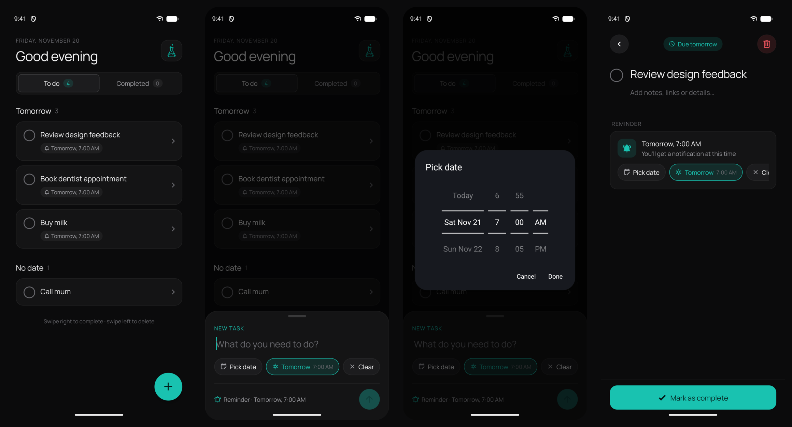

# WorkLabs

A minimal, offline-first to-do app with reminders. Built with React Native, TypeScript and SQLite.



## Features

- **Two lists:** To do and Completed. Nothing else on screen.
- **Quick add:** pick a date, or tap Tonight (9 PM) or Tomorrow (7 AM)
- **Wheel date picker:** day, hour, minute and AM/PM dials, in the style of iOS
- **Reminders:** a local notification at the due time, with Mark as done and Reschedule to 9 PM actions
- **Grouping:** tasks sort themselves into Overdue, Today, Tomorrow, Upcoming and No date
- **Swipe** right to complete, left to delete, with undo
- **Offline:** everything is stored on the device in SQLite

## Design

Near-black surfaces, one teal accent, red only for overdue and delete. [Manrope](https://fonts.google.com/specimen/Manrope)
at weight 400 throughout.

## Tech stack

React Native 0.79 (New Architecture) · TypeScript · op-sqlite · React Navigation 7 · Notifee · react-native-date-picker · Jest

## Getting started

```sh
npm install
cd ios && pod install && cd ..

npm start
npm run android   # or: npm run ios
```

Android is the primary target. The iOS project needs the Manrope font added to the Xcode target before the
typography matches.

## Scripts

```sh
npm run typecheck
npm run lint
npm test
npm run check     # all of the above
```

## Release build (Android)

```sh
cd android && ./gradlew assembleRelease
```

The APK is written to `android/app/build/outputs/apk/release/app-release.apk`.

## Docs

- [Architecture](docs/ARCHITECTURE.md): data flow, database schema, reminders and migrations
- [Troubleshooting](docs/TROUBLESHOOTING.md): common build and runtime issues

## License

The Manrope font is licensed under the SIL Open Font License (see `assets/Manrope-OFL.txt`).
