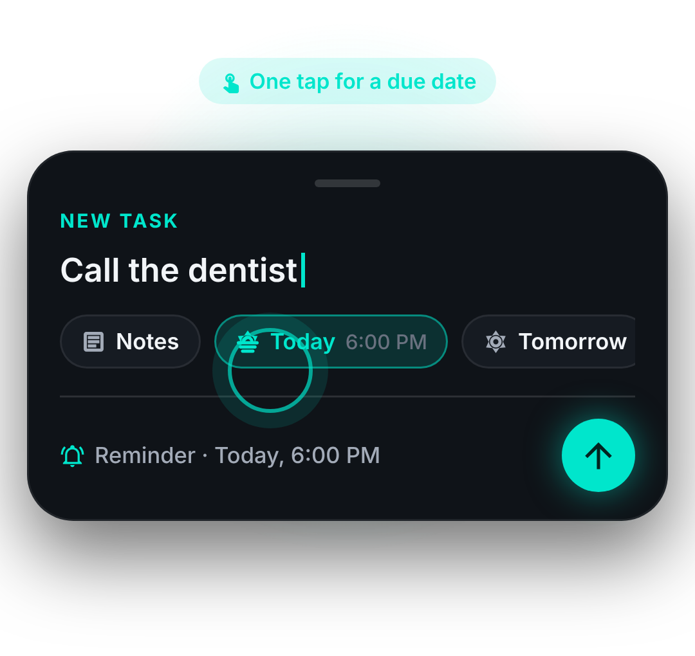
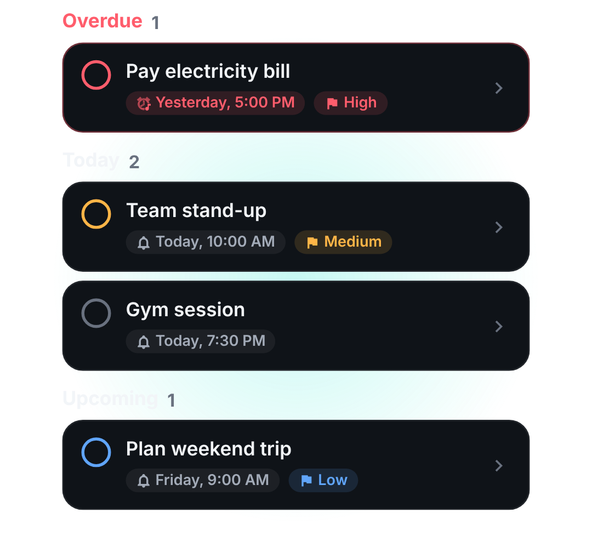
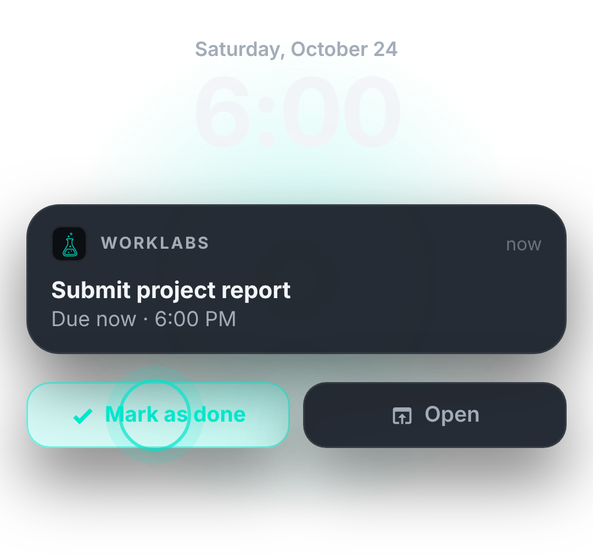

<div align="center">


</div>

---

## About

WorkLabs started as my first React Native app, built while learning the framework from the ground up.
It has since been rebuilt into a production-style codebase: typed end to end, backed by a real SQLite database
with migrations, unit tested, and designed with a consistent dark UI.

Everything stays on the device: no accounts, no servers, no tracking.


<table>
  <tr>
    <td align="center"><br /><b>Capture</b></td>
    <td align="center"><br /><b>Organize</b></td>
    <td align="center"><br /><b>Remind</b></td>
  </tr>
</table>

## Features

- **⚡ Quick add.** Type a title, tap *Today*, *Tomorrow* or *Next week*, then hit send. Notes are one tap away.
- **🗂 Smart sections.** Tasks sort themselves into **Overdue → Today → Tomorrow → Upcoming → No date**.
- **📝 Task screen.** Tap any task to edit its title and notes (autosaved), reschedule it, set a priority,
  see its activity history, complete it or delete it.
- **🔔 Reliable reminders.** Local notifications fire at the due time, using exact alarms on Android.
  You can tap **Mark as done** right on the notification, even when the app is closed.
- **👆 Gestures.** Swipe right to complete and swipe left to delete, with **Undo** on every destructive action.
- **📊 Progress at a glance.** A completion bar plus overdue, due-today and done counts.
- **🔍 Search** across titles and notes.
- **🗄 SQLite storage.** A versioned schema with migrations, one-row writes and indexed queries.
- **♿ Accessible.** Screen-reader labels, roles and states on every interactive element.
- **🎬 Polished details.** Animated splash, illustrated onboarding, spring press feedback, layout animations
  and a native dark launch screen with no white flash.

## Tech stack

| Area          | Choice                                                                                                     |
| ------------- | ---------------------------------------------------------------------------------------------------------- |
| Framework     | React Native 0.79 (New Architecture), React 19                                                             |
| Language      | TypeScript (strict)                                                                                        |
| Storage       | [op-sqlite](https://github.com/OP-Engineering/op-sqlite) (JSI SQLite) with `PRAGMA user_version` migrations |
| Navigation    | React Navigation 7 (native stack)                                                                          |
| Notifications | [Notifee](https://notifee.app) (trigger notifications, actions, channels and categories)                   |
| Gestures      | react-native-gesture-handler                                                                               |
| UI            | Custom design system (`src/theme`), MaterialCommunityIcons, react-native-toast-message                     |
| Quality       | Jest unit tests, ESLint, Prettier, `tsc --noEmit`, GitHub Actions CI                                       |

## Getting started

### Prerequisites

- Node 18+ and the [React Native environment setup](https://reactnative.dev/docs/set-up-your-environment)
- Xcode 16+ with CocoaPods (iOS) and Android Studio with an SDK and emulator (Android)

### Install

```sh
npm install
npm install @op-engineering/op-sqlite   # first time only, see note below
cd ios && pod install && cd ..
```

> If op-sqlite is already listed in `package.json`, a plain `npm install` is enough.

### Run

```sh
npm start          # Metro bundler
npm run ios        # or open ios/worklabs.xcworkspace in Xcode
npm run android
```

> Always open **`ios/worklabs.xcworkspace`**, not the `.xcodeproj`.

### Scripts

| Command             | What it does                                     |
| ------------------- | ------------------------------------------------ |
| `npm run typecheck` | TypeScript type check                            |
| `npm run lint`      | ESLint (React Native config + Prettier)          |
| `npm test`          | Jest unit tests                                  |
| `npm run check`     | All three, the same checks CI runs               |

## Project structure

```
src/
├── components/        Reusable UI: TaskCard, QuickAddSheet, DueDatePicker, ProgressCard, …
├── features/tasks/    Task domain: pure logic, React context store, notification actions
├── hooks/             useNow (a ticking clock so "Overdue" stays accurate)
├── navigation/        Typed route params
├── screens/           Splash, Onboarding, Home, TaskDetail
├── services/          Notifications (Notifee wrapper)
├── storage/           SQLite connection + migrations, repositories, row mappers
├── theme/             Colors, spacing, radii, typography, priority metadata
├── types/             Domain types
└── utils/             Date formatting and quick-date suggestions
__tests__/             Unit tests for logic, dates and DB mappers
docs/                  Architecture notes
```

See **[docs/ARCHITECTURE.md](docs/ARCHITECTURE.md)** for how the pieces fit together: the data flow, the
database schema, the reminder lifecycle and how to add a migration.

## Troubleshooting

<details>
<summary><b>iOS: <code>Library 'DoubleConversion' not found</code></b></summary>

You opened `worklabs.xcodeproj`. Open `ios/worklabs.xcworkspace` instead, then run Product → Clean Build Folder.

</details>

<details>
<summary><b>iOS (Xcode 26): <code>Call to consteval function 'fmt::basic_format_string…' is not a constant expression</code></b></summary>

Newer Apple Clang rejects `fmt` 11.0.2, which ships with React Native 0.79. The `Podfile` already works around this
by compiling the `fmt` pod as C++17. Run `pod install` again after pulling.

</details>

<details>
<summary><b><code>Could not find gem 'cocoapods'</code></b></summary>

Run `bundle install` once in the project root, then `bundle exec pod install`. Or use a globally installed
`pod install`.

</details>

<details>
<summary><b>Reminders arrive late on Android 12</b></summary>

On Android 13+, exact alarms are granted automatically (`USE_EXACT_ALARM`). On Android 12 and 12L the user can turn them
off in Settings → Apps → WorkLabs → *Alarms & reminders*. When they're off, reminders still arrive, but Android may
delay them by a few minutes.

</details>

## Roadmap

- [ ] Recurring tasks (daily or weekly)
- [ ] Sub-tasks and checklists
- [ ] Home-screen widgets
- [ ] Light theme
- [ ] Export and import (JSON)
- [ ] Release signing and store builds
