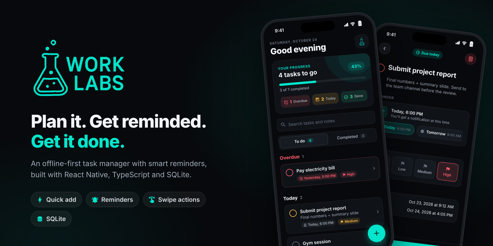
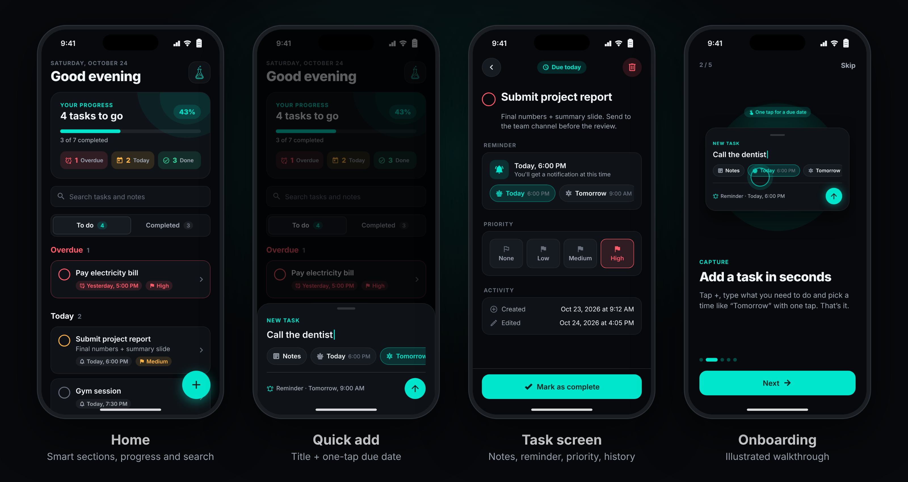

# WorkLabs

An offline-first task manager with reminders, built with React Native, TypeScript and SQLite.

It started as my first React Native project and was later rebuilt into a production-style codebase.



## Features

- Quick add with one-tap due dates: Today, Tomorrow or Next week
- Tasks grouped automatically into Overdue, Today, Tomorrow, Upcoming and No date
- A task screen for notes, reminders, priority and activity history
- Local reminders at the due time, with a Mark as done action on the notification
- Swipe right to complete, swipe left to delete, with undo
- Search, progress stats and an illustrated onboarding
- All data stored on the device in SQLite

## Tech stack

React Native 0.79 (New Architecture) · TypeScript · op-sqlite · React Navigation 7 · Notifee · Jest

## Getting started

```sh
npm install
cd ios && pod install && cd ..

npm start
npm run ios       # or: npm run android
```

On iOS, open `ios/worklabs.xcworkspace`, not the `.xcodeproj`.

## Scripts

```sh
npm run typecheck
npm run lint
npm test
npm run check     # all of the above
```

## Docs

- [Architecture](docs/ARCHITECTURE.md): data flow, database schema, reminders and migrations
- [Troubleshooting](docs/TROUBLESHOOTING.md): common build and runtime issues
