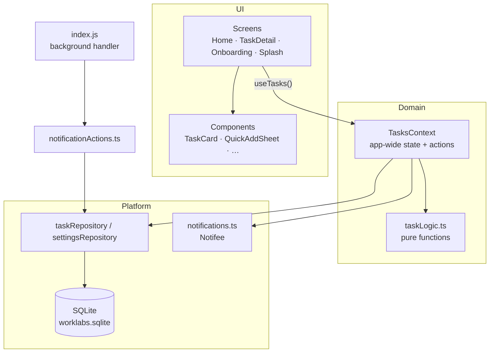

# WorkLabs architecture

This document explains how WorkLabs is put together: how data moves through the app, how it is stored, and how
reminders work. Read it before making non-trivial changes.

## Overview



The code is split into layers. Each layer only depends on the ones below it:

| Layer       | Folder                                     | Responsibility                                            |
| ----------- | ------------------------------------------ | --------------------------------------------------------- |
| Screens     | `src/screens`                              | Compose components, handle navigation and user flows      |
| Components  | `src/components`                           | Presentational, reusable, styled from `src/theme`         |
| State       | `src/features/tasks/TasksContext.tsx`      | Single source of truth for tasks; exposes actions         |
| Logic       | `src/features/tasks/taskLogic.ts`          | Pure, deterministic functions (`now` is passed in)        |
| Persistence | `src/storage`                              | All SQL lives here; the rest of the app sees `Task` objects |
| Services    | `src/services`                             | Native integrations (notifications)                       |

## Data model

```ts
interface Task {
  id: string; // time-based, random suffix
  title: string;
  notes: string;
  priority: 'none' | 'low' | 'medium' | 'high';
  completed: boolean;
  createdAt: string; // ISO 8601
  updatedAt: string;
  completedAt: string | null;
  dueDate: string | null; // the reminder fires at this moment
}
```

### SQLite schema (v1)

```sql
CREATE TABLE tasks (
  id           TEXT PRIMARY KEY NOT NULL,
  title        TEXT NOT NULL,
  notes        TEXT NOT NULL DEFAULT '',
  priority     TEXT NOT NULL DEFAULT 'none'
               CHECK (priority IN ('none', 'low', 'medium', 'high')),
  completed    INTEGER NOT NULL DEFAULT 0 CHECK (completed IN (0, 1)),
  created_at   TEXT NOT NULL,
  updated_at   TEXT NOT NULL,
  completed_at TEXT,
  due_date     TEXT
);
CREATE INDEX idx_tasks_completed_due ON tasks (completed, due_date);

CREATE TABLE settings (key TEXT PRIMARY KEY NOT NULL, value TEXT NOT NULL);
```

- The database opens once, lazily, in `getDatabase()`. It uses WAL mode for fast concurrent reads.
- `mappers.ts` converts rows (snake_case, `0/1` booleans) to `Task` objects and back. It also drops malformed
  rows instead of crashing.
- `settings` is a small key/value table. It currently holds the onboarding flag.

### Adding a migration

Migrations are tracked with SQLite's built-in `PRAGMA user_version`. To change the schema:

1. **Append** a new array of statements to `MIGRATIONS` in `src/storage/database.ts`. Never edit an existing entry,
   because devices that already ran it will not run it again.
2. Update `TASK_COLUMNS`, `taskToParams` and `rowToTask` in `mappers.ts`, plus their tests.
3. Each migration runs in a transaction. If one fails, nothing is applied, and the app retries on the next launch.

```ts
const MIGRATIONS = [
  [/* v1 … */],
  // v2
  ["ALTER TABLE tasks ADD COLUMN repeat TEXT"],
];
```

## State and data flow

`TasksProvider` (mounted in `App.tsx`) loads every task when the app starts, while the splash animation plays.
After that it is the single source of truth for the UI.

Every action follows the same pattern:

1. **Update React state optimistically.** The UI responds instantly, and a `LayoutAnimation` animates list changes.
2. **Persist one row.** It calls `saveTask` or `deleteTaskById`, which is fire-and-forget. Failures are logged in development.
3. **Sync the reminder.** It schedules or cancels the reminder for that task.

A `tasksRef` mirrors state, so action callbacks stay stable and always see the latest list. This avoids stale
closures and needless re-renders of the memoised `TaskCard`.

The provider also reloads from the database when:

- the app returns to the foreground, to pick up a task completed from a notification while backgrounded, and
- a foreground notification action changes a task.

### Derived data

Screens never store derived data. Sections, counts, search results and stats are computed with `useMemo` from
`tasks` and `now`, using the pure functions in `taskLogic.ts`:

- `groupActiveTasks(tasks, now)` splits tasks into Overdue, Today, Tomorrow, Upcoming and No date. Within a
  section, tasks are ordered by due date, then priority, then creation time.
- `getStats(tasks, now)` returns the numbers for the progress card.
- `useNow()` ticks every minute and when the app is foregrounded, so "Overdue" labels stay accurate.

## Reminders

`src/services/notifications.ts` wraps Notifee. Each reminder uses the **task id as its notification id**. That keeps
the rules simple:

| Event                                  | Effect                                   |
| -------------------------------------- | ---------------------------------------- |
| Task created or rescheduled with a future due date | `createTriggerNotification` (replaces any existing reminder) |
| Task completed, deleted or date cleared | `cancelNotification(task.id)`            |
| App launch                             | `syncReminders()` reconciles scheduled reminders against the database |

- **Permissions.** The app asks when you first set a due date, not at launch. On iOS this uses
  `requestPermission()`; on Android 13+ it requests the `POST_NOTIFICATIONS` runtime permission.
- **Android channel.** `task-reminders` is created with high importance.
- **Exact alarms.** Reminders use `SET_EXACT_AND_ALLOW_WHILE_IDLE`, so they fire on the minute, even in Doze mode.
  `USE_EXACT_ALARM` grants this automatically on Android 13+, and `SCHEDULE_EXACT_ALARM` covers Android 12.
  Notifee **silently drops** an exact trigger when the permission is missing; it doesn't throw. So
  `scheduleReminder` checks `canScheduleExactAlarms()` first and falls back to a regular (WorkManager) trigger.
  Note: Google Play restricts `USE_EXACT_ALARM` to alarm, calendar and reminder-style apps. Mention the
  reminder use case when you publish.
- **Mark as done.** This is an Android action plus an iOS category. When the app is killed, `index.js` registers
  `notifee.onBackgroundEvent`, which runs `handleNotificationEvent` headlessly and updates SQLite directly.

## Navigation

The app uses a native stack (`src/navigation/types.ts` holds the typed params):

```
Splash (not a route; shown while the DB opens)
  └─ Onboarding  → shown only on first launch (flag in `settings`)
  └─ Home
       └─ TaskDetail { taskId }
```

`TaskDetail` reads the task live with `useTask(id)`, autosaves title and notes 500 ms after you stop typing (and on
leaving the screen), and goes back automatically if the task is deleted.

## Design system

All visual values come from `src/theme/index.ts`:

- **Colors.** A near-black background (`#07090C`) with layered surfaces, plus the brand teal (`#00E6CC`) and
  semantic colors (danger, warning, success, info), each with a matching "soft" tint for backgrounds.
- **Spacing, radius and typography.** Shared scales, so components line up.
- **Priority metadata.** `PRIORITY_META` holds each priority's label, color and icon, and is used everywhere
  priorities are shown.

The native launch screens (iOS `LaunchScreen.storyboard`, Android `windowBackground`) use the same background color,
so there's no flash between the OS splash and the animated JS splash.

## Testing

Business logic is kept free of React and native modules so it can be tested in plain Jest:

| Test file                       | Covers                                                                        |
| ------------------------------- | ----------------------------------------------------------------------------- |
| `__tests__/taskLogic.test.ts`   | Creating and updating tasks, completion, overdue rules, grouping, sorting, search, stats |
| `__tests__/date.test.ts`        | Formatting, relative days, quick-date suggestions (never in the past)         |
| `__tests__/mappers.test.ts`     | DB row ↔ Task round-trips and sanitising bad rows                             |

All time-dependent functions take `now` as a parameter, so the tests are deterministic.

## Release checklist

- [ ] Release signing (Android keystore, iOS team and provisioning). Not set up yet.
- [ ] Set a unique iOS bundle identifier (currently the template default)
- [ ] Bump `versionCode` / `versionName` (Android) and `MARKETING_VERSION` (iOS)
- [ ] Enable R8/ProGuard (`enableProguardInReleaseBuilds`) and smoke-test the release build
- [ ] Add store screenshots and a privacy policy (the app collects no data)
